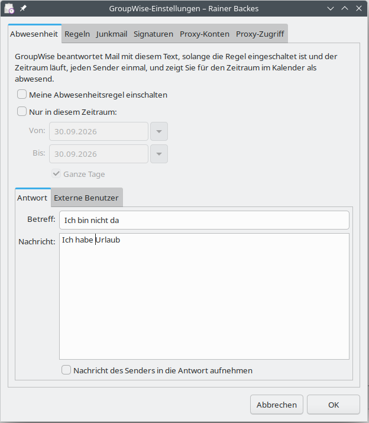
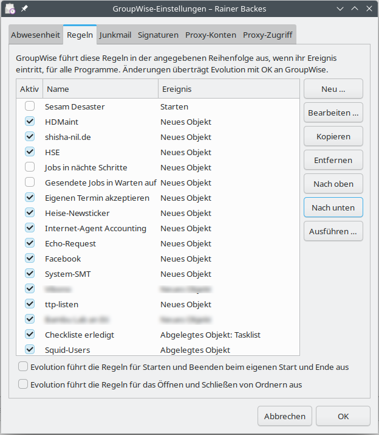
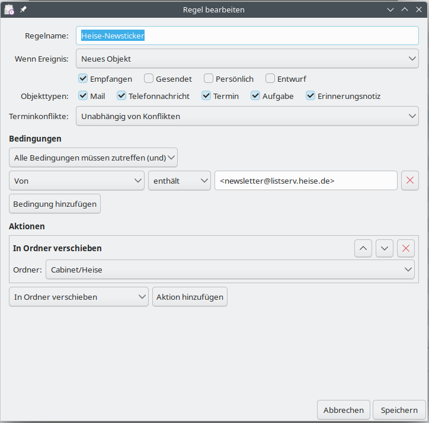
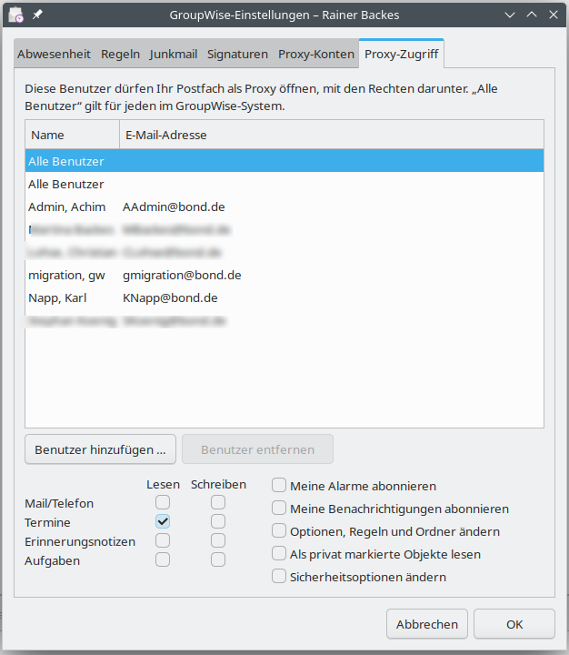
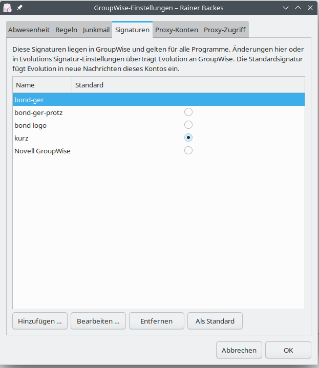
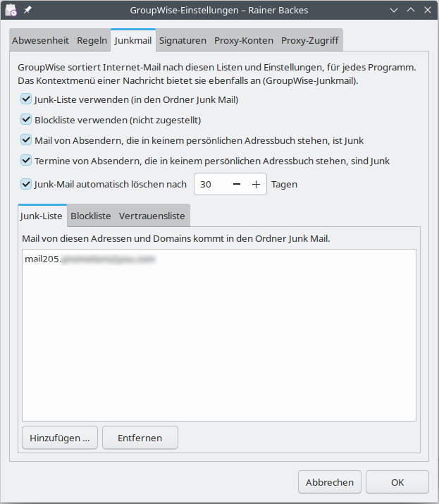
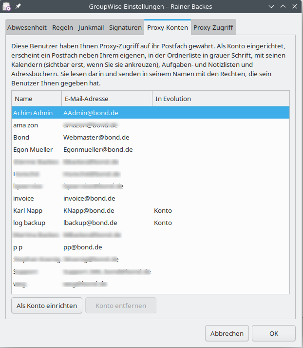

<!--
  Benutzerhandbuch von evolution-groupwise als Markdown zum Bearbeiten.
  Quelle für das PDF bleibt Benutzerhandbuch.html; Claude überträgt die
  Änderungen dorthin. Menünamen stehen in `Backticks`, **fett** und *kursiv*
  wie gewohnt, Hinweiskästen als Zitat (> ...), Bilder als 
  (die Beschreibung wird zur Bildunterschrift). Das Inhaltsverzeichnis
  entsteht automatisch aus den Überschriften.
-->

# evolution-groupwise

User Guide

GroupWise mailboxes in Evolution: mail, address books, calendars, tasks and memos over the SOAP interface of the GroupWise Post Office Agent.

Version 0.11.2 · November 2026 bond Software Entwicklung GmbH License: GNU Lesser General Public License 2.1 or later

# 1 Overview

evolution-groupwise integrates GroupWise mailboxes directly into the mail and groupware program **Evolution**. It talks to the GroupWise Post Office Agent (POA) over its SOAP interface — the same path GroupWise Web uses. No additional service and no detour through IMAP is needed.

A single login gives you:

- **Mail**: all folders of the mailbox, read and write, move, copy, delete, drafts, sending through GroupWise — recipients get a genuine GroupWise message.

- **Address books**: the GroupWise address book (read-only), “Frequent Contacts” and your personal address books (read and write), with autocompletion while writing.

- **Calendar**: appointments, all-day appointments, series, reminders, meetings with invitations and answers, free/busy search; your own subcalendars, proxy calendars and calendars shared with you, as calendars of their own.

- **Proxy access**: the mailboxes of other users who have given you proxy rights, as accounts of their own next to yours — mail, calendar, tasks, memos and address books, read and write in their name; and managing who may access your own mailbox.

- **Tasks and memos** from the GroupWise calendar.

- **Categories** from GroupWise as labels (mail) and categories (calendar).

## Terms: GroupWise and Evolution

Evolution and the GroupWise client sometimes name the same thing differently. The table lines up the names; the English names are also the ones used in the *GroupWise Client User Guide*, which this manual cites throughout chapter 10.

| Evolution | GroupWise Client | What it is |
|---|---|---|
| Appointment | Personal Appointment | An entry only in your own calendar, with no attendees |
| Meeting | Meeting | An appointment with attendees that is sent as an invitation |
| All Day Appointment; in the editor the option `All Day Event` | the option `All Day Event` when creating an appointment, personal or with attendees | An appointment with no time, spanning whole days. GroupWise shows an all-day event as “free” by default, so other appointments on that day are possible without a conflict (a three-day trade fair and the appointments at the fair). Evolution otherwise makes every appointment “busy”; in a GroupWise calendar, a new all-day appointment starts out free from the beginning, just as in the GroupWise client. Change this with `Options → Show Time as Busy` in the editor; it arrives in GroupWise as “free” or “busy” and the other way round too. |
| Task | Personal Task | A task only for yourself |
| Assigned Task | Task | A task that is sent to others |
| Memo | Personal Reminder | A note on a given day, only for yourself |
| Shared Memo | Reminder | A note on a given day that is sent to others |
| – | Sticky Note | A personal note with no date; Evolution has no equivalent for it |
| Mail Message | Mail | A message |
| Phone Message | Phone Message, “While You Were Out” and the personal phone message | A message with extra fields for the caller, company, phone number and checkboxes (telephoned, please call, urgent …). Evolution shows a received one as a message; the fields appear as their own paragraph above the message text. You write one with `File → New → Phone Message` ([4.2](#mail-telefon)). |
| Tasks (the view) | Tasklist | The list of open tasks; the GroupWise Tasklist additionally contains messages you have flagged for follow-up |
| Organizer | From | Who schedules a meeting |
| Attendees | Recipients: To, Copy (CC), Blind Copy (BC) | Who is invited; Evolution instead distinguishes required and optional attendees |
| Label (for mail), Category (in the calendar) | Category | Color-coded marking |
| Search Folder | Find Results Folder | A folder that shows the result of a saved search |

This manual uses Evolution’s names; where it helps clarity, the GroupWise name is given alongside.

## Requirements

| Component | Requirement |
|---|---|
| Evolution and evolution-data-server | 3.52 or newer (e.g. openSUSE Leap 16, openSUSE Tumbleweed, Ubuntu 24.04, a current Fedora). The “Restore” function in the Trash needs Evolution 3.56. |
| GroupWise | Post Office Agent with an active SOAP interface (default port 7191); developed and tested with GroupWise 26.2. |
| Credentials | A GroupWise user ID and password. |

# 2 Installation

## Installing from a Package

RPM packages are available for openSUSE and Fedora, a .deb package for Debian and Ubuntu. Install the package with your system’s package manager, for example on openSUSE:

```
sudo zypper install ./evolution-groupwise-0.11.2-0.x86_64.rpm \
                    ./evolution-groupwise-lang-0.11.2-0.noarch.rpm
```

or on Debian/Ubuntu:

```
sudo apt install ./evolution-groupwise_0.11.2_amd64.deb
```

The package `evolution-groupwise-lang` contains the German translation (for now; more languages may follow). Afterwards, restart Evolution and the background services, most easily by logging out and back in, or with:

```
evolution --force-shutdown
```

## Building from Source

For developers and for testing, the module can be built with CMake and installed into the home directory without administrator rights. The commands for that are in the file `README.md` of the sources. Such a developer install must be removed again before installing a package, or Evolution loads every module twice.

# 3 Setting Up an Account

1. In Evolution, choose `File → New → Mail Account`.

2. Enter your name and your e-mail address.

3. Choose **GroupWise** as the server type. Server, port (7191) and user name are pre-filled from the e-mail address: *user@company.com* becomes the user *user* on the server *mail.company.com*. Correct the values if your GroupWise user ID or the POA are named differently.

4. Finish the assistant and enter your password the first time it connects. Evolution can store it in the keyring.

There is no page for outgoing mail: messages are sent through GroupWise itself. The account then appears in the mail view, and its address books, calendars, task lists and memo lists appear under the account’s heading in their respective views.

## Certificate of the POA

GroupWise usually issues the certificates of its agents with its own, internal certificate authority (CA), which Linux does not trust at first. Evolution therefore asks, the first time it connects, just like the GroupWise client, whether it should trust the POA’s certificate. Check the details shown and choose `Accept Permanently`; the acceptance applies to the whole account with its calendars and address books. If the POA’s certificate is renewed later, Evolution asks once more — again just like the GroupWise client.

The certificate must be issued for the name under which you address the POA (for example *mail.example.com*); otherwise Evolution rejects the connection as insecure despite your acceptance.

> **For administrators:** If the CA of the GroupWise system is known, the question about a renewal is skipped too. Put the CA file (PEM)

- > for all users of a machine into `/etc/pki/trust/anchors/` (openSUSE) or `/usr/local/share/ca-certificates/` (Debian/Ubuntu) and run `sudo update-ca-certificates`, or

- > for a single user into `~/.config/evolution-groupwise/ca/`.

> The POA does not supply the CA itself, but the GroupWise administration service (port 9710) does, in its certificate chain. Before using it, compare the fingerprint with the one in the GroupWise administration console:

```
openssl s_client -connect mail.example.com:9710 -showcerts </dev/null 2>/dev/null \
  | awk '/BEGIN CERT/{n++} n==2{print} /END CERT/ && n==2{exit}' > groupwise-ca.pem
openssl x509 -in groupwise-ca.pem -noout -subject -fingerprint -sha256
```

## Account Options

Under `Edit → Preferences → Mail Accounts → Edit` you will find:

| Option | Meaning |
|---|---|
| Ask the server every … seconds for changes in the mailbox | GroupWise notes, on request, what happens in the mailbox: new, read, moved and deleted messages. With this option, Evolution polls that list at the set interval (default 60 seconds, minimum 15) and only synchronizes the affected folders. New messages and anything you do in the GroupWise client or on a mobile device then appear within this interval instead of only at the next full account fetch; the request itself is small. This saves time especially for proxy accounts. The usual fetch continues as well. The option also applies to the account’s **calendars, tasks and memos**: appointments you create, change or delete in the GroupWise client or on a mobile device, and incoming invitations, appear just as quickly instead of only at the next calendar sync (every 15 minutes) — as long as Evolution is running. Off unless you turn it on; turning it off again makes Evolution remove the markers from the mailbox. Your proxy accounts (section 4.8) take over this setting from your own account, including the interval: you only set it there. |
| The server reports changes at once, on port … of this computer | In addition to the request above: GroupWise reports to Evolution by itself as soon as something happens in the mailbox; new messages then appear after one or two seconds. For this, the GroupWise server (POA) opens a connection *to your computer*, on the given TCP port (default 5221). This only works if the server can reach your computer — on a company network, not behind a home router — and if your computer’s firewall lets the port through. If Evolution finds that the reports are not arriving, it asks whether it should open the port in the firewall (`Open the Port`, `Not Now`, `Do Not Ask Again`); the system asks for the administrator password for that. Without incoming reports, the interval of the request above simply applies. After turning on or changing either option, it takes a few minutes before the server also reports messages from outside and actions in the GroupWise client at once. Only selectable together with the request; off unless you turn it on. Your proxy accounts take over this setting as well. |
| Apply filters and junk checking to new messages in the mailbox | Evolution’s own filter rules and junk detection run over newly arrived messages. For this, Evolution downloads every new message in full; the option is therefore off unless you need it. |
| Copy folder content locally for offline operation | Messages are downloaded ahead of time so they can be read without a connection. |
| Read-only: never change anything on the server | Evolution only reads. Read status, moving, deleting and sending are not sent to the server — useful for trying things out. |
| Run the rules for startup and exit when Evolution starts and quits | See section “Rules”: Evolution lets GroupWise run the rules with the *Startup* and *Exit* event. Off unless you turn it on. |
| Run the rules for opening and closing folders | Likewise for the *Folder Open* and *Folder Close* events. |

> **Several computers on the same mailbox:** For polling changes, Evolution creates a marker in the mailbox that belongs to exactly one computer; its name contains an identifier of the computer (from the system’s machine ID) and your login name. Accessing the same mailbox from two computers, each has its own — that works. Problematic are **cloned computers** (copied virtual machines, rolled-out images): they have the same machine ID and take each other’s changes away, so each only gets part of them; the instant notification, too, then goes to only one of the two. Give a cloned computer a new machine ID. To do that, first turn the option off in Evolution (then Evolution removes the old marker from the mailbox), set a new machine ID as administrator, reboot the computer and turn the option back on:

```
sudo rm -f /etc/machine-id /var/lib/dbus/machine-id
sudo systemd-machine-id-setup
```

> Other parts of the system use the machine ID too; it is best to set it anew right after cloning, before you even set up Evolution.

## GroupWise Settings

Settings that the GroupWise server itself keeps for your mailbox are edited in the **GroupWise Settings** window: right-click the name of the GroupWise account in the folder list and choose `GroupWise Settings…`. The window reads the settings from the server when it opens and writes your changes back with `OK`; they then apply to every program, including the GroupWise client and GroupWise Web. It has the tabs **Out of Office**, **Rules** (see below), **Junk Mail** (see section 4.5), **Signatures** (see section 4.2), **Proxy Accounts** (see section 4.8), **Proxy Access** and **Mailbox and Password** (both see below). In the GroupWise client you find the same settings under the *Tools* menu.

For a proxy account (section 4.8), `GroupWise Settings…` shows the Out of Office and junk mail settings of the other mailbox. This requires that the other user has given you the proxy right “Modify options, rules and folders”; otherwise the window reports this. The “Proxy Accounts” and “Proxy Access” tabs do not appear there.

## Out of Office

The **Out of Office** tab corresponds to the out-of-office rule of the GroupWise client:



- **Turn on my out of office rule** – while the rule is turned on (and the period is running, if one is set), GroupWise automatically answers incoming mail, each sender only once.

- **Only during this period** – from and to a day (**Whole days**) or a time of day. GroupWise enters an appointment with the status *Out of Office* into your calendar for the period and removes it again once you turn the rule off. After the end of the period, GroupWise stops answering, even if the rule stays on.

- **Reply** – subject and text of the automatic reply; the subject appears in parentheses after the subject of the original message. Optionally, the sender’s message is included in the reply.

- **External users** – whether senders outside the GroupWise system are answered too, either all of them or only your contacts, with a subject and text of their own (the text of the “Reply” tab does not apply to them).

## Rules

The **Rules** tab corresponds to *Tools → Rules* in the GroupWise client. GroupWise runs the rules itself, for every program, in the order of the list.



- **List**: the *Active* checkbox turns a rule on or off; `Move Up` and `Move Down` change the order; `New…`, `Edit…` (or double-click), `Copy` and `Delete` work as usual. Evolution sends all changes to GroupWise with `OK`.

- `Run…` lets GroupWise apply the saved rule to the objects of your mailbox at once (after a confirmation), for example a user-activated rule.

The **Rule Editor** does not have quite the scope of the GroupWise client, but is noticeably easier to use and should be enough for everyday use:



- **Event**: *New Item* (with the sources Received, Sent, Personal, Draft), *Filed Item*, *Folder Open*, *Folder Close* (each for one folder or for any), *Completed Item*, *Startup*, *Exit* and *User Activated*.

- **Item types**: Mail, Phone Message, Appointment, Task, Reminder Note; for appointments, also whether the rule applies only without or only with a scheduling conflict.

**Conditions**: any number, combined with “All conditions must be met (and)” or “Any condition must be met (or)” (one level, no nested groups). The field names match the GroupWise client:

   - Text (contains, does not contain, begins with, matches, is not): From, To, CC, Subject, My Subject, Message, Place, Attachments, Note, Submitted By, Account, and the caller’s name, company and phone number;

   - Dates, compared with today plus a number of days (e.g. “before today plus −3” = older than three days): Created, Delivered, Started, Ends, Due By, Delegated Date, Completion Date;

   - Numbers (=, ≠, >, ≥, <, ≤): Size, % Complete, Job Priority; Job Category (a single letter);

   - Counters of sent items – Accepted, Replied, Completed, Deleted, Opened Totals, Total Users – against a number or against another counter (plus an offset), for example “Completed Total = field Total Users”: every recipient has completed the task;

   - Choice fields: Priority (High, Standard, Low), Delivery Type (To, CC, BC), Message Status (Accepted, Completed, Opened, Read, Private), Extended Message Status (states of third-party archiving), Thread State (Collapsed, Watched, Ignored), Attachment List and Personal Attachments (File, Audio, Film, Object (OLE), Document Reference, Mail, Appointment, Task, Note, Phone Message), Mentions (me), Send Options (Reply Requested).

- The editor does not offer document and library fields, or X-fields of Internet mail.

- **Actions**, in their order: Send Mail, Forward, Forward as Attachment, Delegate, Reply, Accept, Category, Delete/Decline, Prune Message, Move to Folder, Link to Folder, Mark Private, Mark Read, Mark Unread, Stop Rule Processing, and last **Reply Unconditionally (Dangerous)**.

> **Reply and reply unconditionally:** *Reply* is GroupWise’s automatic reply: it answers each sender at most once a day and avoids message loops. *Reply Unconditionally (Dangerous)* is its predecessor and answers every message without any restriction – two such rules, a mailing list, or another out-of-office notice can answer each other endlessly. Use it only if you really need it.

Rules with parts the editor cannot display (nested condition groups, document or X-fields, other actions such as Archive) are shown only; you can still turn them on and off, move, run and remove them. Edit them in the GroupWise client.

The events *Startup*, *Exit*, *Folder Open* and *Folder Close* are triggered by the client in GroupWise, not the server. The two checkboxes below the list (also in the account options) decide whether Evolution takes this over: at Evolution’s start and exit, and on opening and leaving a folder respectively. Both are off at first – keep in mind that such rules can, for instance, delete messages permanently.

## Proxy Access to Your Mailbox

The **Proxy Access** tab corresponds to proxy access in the security options of the GroupWise client: it determines who may open your mailbox as a proxy, and with what rights.



- The list shows the users with access; at the very top is **All Users**, the rights given to everyone in the GroupWise system (typically: read appointments, for free/busy scheduling).

- `Add User…` asks for the e-mail address or the name of a GroupWise user; they initially get the right to read mail and appointments. `Remove User` takes their access away.

- For the selected user, set the rights below: **Read** and **Write** for Mail/Phone, Appointments, Reminder Notes and Tasks (Write includes Read), plus *Subscribe to my alarms*, *Subscribe to my notifications*, *Modify options, rules and folders*, *Read items marked private* and *Modify security options*.

With `OK`, Evolution sends the changes to GroupWise.

## Mailbox and Password

The **Mailbox and Password** tab of the GroupWise settings shows the mailbox in figures, like *Tools → Check Mailbox Size* in the GroupWise client:

- **Space**: how much the mailbox uses and how large it may grow, as a bar and in megabytes, plus the threshold at which GroupWise warns you. If the mailbox has no size limit, only the space used is shown.

- **Content**: the number of messages in the folders and how many of them are unread, the entries in the calendar, and the number of folders, calendars and address books, as well as the contacts in them.

- A **list of folders** with messages and unread ones, fullest first; clicking a column heading re-sorts it. GroupWise counts the Mailbox, the Calendar, Work In Progress and the folders you created; Sent Items, other views of the mailbox, and folders other users have shared with you, are not counted.

The figures are the state when the window was opened. For a proxy account, they describe the other mailbox.

`Change Password…` opens the **Change the Password of the Mailbox** dialog: old password, new password and its repetition, then `Change`. GroupWise changes the password at once – independent of `OK` or `Cancel` of the settings window. Evolution remembers the new password in the keyring, also for your proxy accounts; other programs and devices that use the mailbox (GroupWise Web, mobile devices) need it as well. The button only appears for your own account.

> **Passwords from a directory service:** If your GroupWise system checks passwords against a directory service (LDAP), change the password there; GroupWise then refuses the change here, and the dialog shows the server’s message.

# 4 Mail

## 4.1 Folders and Messages

Evolution shows all folders of the GroupWise mailbox, like the GroupWise client, system folders first in its order – Mailbox, Sent Items, Tasklist, Work In Progress (Drafts), Junk Mail, Trash, Cabinet with all its subfolders –, then your own folders and the search result folders, by name. The system folders carry the names the GroupWise client also shows in your language. Set an order yourself in Evolution (context menu of a folder, `Edit Sort Order…`), and that one applies. Folders shared by other users whose parent folder no longer exists are hidden, like in the GroupWise client. Folders can be created, renamed, moved and deleted. System folders such as the Mailbox or the Trash stay as they are.

- **Message list**: sender, subject, date, size, attachment icon, priority and read status come directly from GroupWise. The content of a message is loaded only when it is opened.

- **Original message**: messages received from outside are shown by Evolution as they arrived, with all header lines.

- **Changed subject**: if you changed the subject of a message in the GroupWise client, Evolution shows the changed subject.

- **Read/unread** is synchronized both ways. Merely viewing it in the list marks nothing as read.

- **Number of unread**: as in the GroupWise client, each folder shows how many unread messages it contains – even for folders you have not yet opened. For those, it is the state of the last folder-list sync (at startup and on `Send/Receive`); an opened folder is counted continuously. Folders other users have shared with you are counted by the server only once you open them.

- **Moving and copying** within the account happens on the server: a copied message is, in GroupWise, the same message in a further folder.

- **Invitations** in the Mailbox appear as messages; answer them in the message view or in the calendar. Answered invitations disappear from the Mailbox, like in the GroupWise client.

Evolution checks for new messages regularly. Between two full syncs (at most every 15 minutes), it only asks for the changes since the last time.

## 4.2 Writing and Sending

Messages are sent through GroupWise: internal recipients get a native GroupWise message, external ones an ordinary e-mail. The sent message then lies in Sent Items.

- **HTML and text**, embedded images, attachments and priority are carried over.

- **Drafts** are stored in the *Work In Progress* folder and so are also visible in the GroupWise client.

- **Forward as Attachment**: if you forward a GroupWise message as an attachment, GroupWise attaches the message itself, like the GroupWise client. Internal recipients see it as a GroupWise message, not as a MIME file.

- **Replying** to a message of the account links it to the original in GroupWise, like the GroupWise client: the original is marked as replied there, and the reply appears below it in the discussion view. If you reply with a different mailbox as sender ([4.8](#mail-proxy)), the reply goes without this link.

- **Sender**: sending always goes through the account to which the chosen sending identity belongs. Several GroupWise accounts side by side are possible.

### Delivery Status and Retracting

As in the GroupWise client, for sent messages you can see what happened to them at the recipients, and retract them. Both are in the *Sent Items* folder of a GroupWise account, in a message’s context menu and in the `Message` menu:

- `Delivery Status…` opens a window for the selected message with all recipients (To, CC, BC) and, below each, every event with its time: delivered, opened, deleted, replied, forwarded, retracted, accepted or declined for appointments (with a comment), and more. For recipients outside GroupWise, usually only “Transferred” appears.

- `Resend…` opens the message, as in the GroupWise client, in a new message window where you can change it. The signature is set to “None”, because the message already contains its signature. On `Send`, Evolution asks whether the original message should be retracted from the recipients: `Retract`, `Do Not Retract` or `Cancel` (back to the message window).

- `Retract…` pulls the selected messages back out of the recipients’ mailboxes in GroupWise, after a confirmation. The sent message stays in Sent Items; its delivery status then shows the recipients as “Retracted”. Recipients outside GroupWise have already received the message. For a read-only account, the entry is missing.

### Notification When the Recipient Opens It

Check `Options → Request Read Receipt` in the editor, and Evolution asks GroupWise for the **“When Opened” return notification** as mail (in the GroupWise client: *Send Options → Notify → When Opened: Mail Receipt*). As soon as a recipient in the GroupWise system opens the message, GroupWise puts a message “*Name* opened *Subject*” into your Mailbox – without the recipient doing anything; they are not asked. For recipients on the Internet, GroupWise requests an ordinary read receipt, which their mail program decides on.

For this to apply to every message, turn on “Always request a read receipt” under `Edit → Preferences → Composer Preferences → General`. Independent of that, `Delivery Status…` in Sent Items shows at any time who has had a message delivered, opened or deleted.

### Phone Messages

A phone message records, for someone, who called while they were away. Choose `File → New → Phone Message` or the same entry in the dropdown of the `New` button in the toolbar – in any view, as in the GroupWise client. The **Phone Message** dialog:

- **From** – the mailbox to send from; the choice only appears if you have proxy accounts besides your own. Preselected is the account of the folder selected in the mail view, otherwise your own.

- **To** – the recipients: typed, with completion from the address books, or chosen via `Address Book…`.

- **Caller**, **Company**, **Phone**.

- The checkboxes **Telephoned**, **Please Call**, **Will Call Again**, **Returned Your Call**, **Wants to See You**, **Came to See You** and **Urgent**.

- **Message** – the text.

`Send` sends it through GroupWise. A phone message has no subject of its own: as in the GroupWise client, the caller and the phone number stand in for it. Recipients see it in the GroupWise client as a phone message and in Evolution as a message with the call details above the text; for you, it lies in Sent Items. At least one recipient and either the caller or a text are required.

### Signatures

Your signatures from GroupWise are available in Evolution: in the `Signature:` field of the message editor, and under `Edit → Preferences → Composer Preferences → Signatures`, with images. Evolution inserts GroupWise’s default signature into new messages of the account, even if GroupWise is set to ask before sending; in the editor, choose another one or “None”. The signatures of a proxy account carry the account’s name, e.g. “Karl – Karl Napp (Proxy)”.

Edit signatures in the **GroupWise Settings** window, **Signatures** tab:



- `Add…` and `Edit…` open Evolution’s signature editor; on save, Evolution sends the signature to GroupWise.

- `Remove` deletes the signature, in GroupWise too.

- `Set as Default` makes the selected signature, with `OK`, the default signature in GroupWise and the account’s signature in Evolution.

Changes and deletions under `Composer Preferences → Signatures` are also sent to GroupWise by Evolution. New signatures you create there with `Add`, however, stay in Evolution only, because they are not tied to an account. Changes made in the GroupWise client are taken over by Evolution the next time the account connects. Removing a whole account leaves its signatures in GroupWise untouched.

> **Recommendation: write messages in HTML.** If you write a plain message in the GroupWise client, it uses its own, extended text format dating back to GroupWise’s early days. Evolution cannot process this format; a plain-text message in Evolution is therefore really just text. The HTML format, today’s standard for e-mail, makes more sense. Under `Edit → Preferences → Composer Preferences`, set `Format messages in` to **HTML**. Then Evolution inserts the signature with formatting and images, the way GroupWise stores it. If you write in “Plain Text” format instead, Evolution inserts the text version of the signature, and it stays plain text even if you switch the format to HTML afterwards in the choice above the message text; only choosing the signature again (for example “None” and then the signature once more) fetches the HTML version.

> **Note:** Signed or encrypted messages (S/MIME, PGP) cannot be sent through GroupWise, because the POA assembles the message for the recipients itself. Evolution reports this when sending.

## 4.3 Deleting and the Trash

Deleted messages move into the GroupWise Trash, as in the GroupWise client.

- **Restore**: select messages in the Trash and choose `Restore` at the very top of the context menu, or under `Edit → Restore`. The messages return to the folders they were deleted from. If a folder no longer exists, they go to the Mailbox. (Needs Evolution 3.56.)

- **Empty Trash** (context menu of the Trash or of the account, `Empty Trash`) deletes permanently whatever is no longer in any other folder. Messages that are still in another folder (because only one copy was deleted) merely leave the Trash and remain in their folders.

- **Delete Permanently** (`Shift+Delete`, or delete and purge) removes a message from every folder at once, without the detour through the Trash.

## 4.4 Labels and Categories

GroupWise categories appear in Evolution as **labels**. GroupWise’s four predefined categories correspond to Evolution’s standard labels:

| GroupWise | Evolution |
|---|---|
| Urgent | Important |
| Personal | Personal |
| Follow-up | To Do |
| Low priority | Later |

- Your **own categories** are added, with their GroupWise color, to Evolution’s label list when connecting (`Edit → Preferences → Mail Preferences → Labels`). Categories hidden in GroupWise stay out.

- Setting or removing a label (context menu `Label`) sets or removes the category in GroupWise. A label GroupWise does not yet know as a category – say “Work” – is created there as a new category.

- Categories set in the GroupWise client appear in Evolution at the next sync.

### Follow-Up and the Tasklist

What Evolution calls “Follow Up” is not a message of its own, but a **marker for follow-up** on an existing message, optionally with a due date. The message list shows it with a flag, completed ones with a check mark. This is exactly GroupWise’s **Tasklist**, and Evolution synchronizes both ways:

- `Mark for Follow Up…` puts the message on the Tasklist, with the due date chosen there (`Due By`). The message stays in its folder; in the GroupWise client it additionally appears in the Tasklist.

- `Mark as Complete` checks it off as done in the Tasklist; if the check mark is removed again in the GroupWise client, it is open again in Evolution.

- `Clear Flag` takes it off the Tasklist; the message itself remains.

- Conversely, Evolution shows messages that were put on the Tasklist in the GroupWise client as flagged, with their due date and completion state. GroupWise does not know the text of the flag (“Follow up”, “Reply” …); it stays in Evolution only.

Flags you had already set in Evolution before version 0.8.0 are carried over to the Tasklist at the first sync.

## 4.5 Junk Mail

GroupWise sorts unwanted Internet mail itself: by a **junk list** (mail goes into the “Junk Mail” folder), a **block list** (mail is not delivered at all) and a **trust list** (mail is never junk; it takes precedence). Entries are e-mail addresses or Internet domains. The lists do not apply to internal mail from the GroupWise system.

- **Mark as Junk** (context menu `Mark as Junk`, or `Ctrl+J`): the message moves into the “Junk Mail” folder, and its sender goes onto GroupWise’s junk list (and off the trust list).

- **Mark as Not Junk** (context menu `Mark as Not Junk`, or `Shift+Ctrl+J`) in the “Junk Mail” folder: the message returns to the Mailbox, and its sender goes onto the trust list (and off the junk and block lists).

- Evolution no longer shows an extra junk folder of its own; messages Evolution’s own junk check recognizes are only moved, the lists stay unchanged.

As in the GroupWise client, you can also specifically classify an address or a whole domain: a message’s context menu has, right below Evolution’s own entries, the submenu `GroupWise Junk Mail` with

- `Trust the Sender…` – onto the trust list; the message comes back from “Junk Mail” into the Mailbox,

- `Junk the Sender…` – onto the junk list; the message goes into the “Junk Mail” folder,

- `Block the Sender…` – onto the block list; future mail is no longer delivered, the message goes into the “Junk Mail” folder,

- `Junk Mail Settings…` – opens the account’s GroupWise settings on the “Junk Mail” tab.

A dialog asks each time whether only the address or the whole domain (with its subdomains) is entered. In the folders of a proxy account ([4.8](#mail-proxy)), the submenu acts on the lists of the other mailbox; this needs the proxy right “Modify options, rules and folders”.

Below that is `Add sender to address book` (elsewhere in Evolution only in the `Message` menu): a dialog lets you choose the destination address book; completing the entry lets you add further details. With the setting “Mail from senders who are not in any personal address book is junk”, a sender in one of your personal GroupWise address books counts as wanted.

The settings and lists themselves are edited in the **GroupWise Settings** window, opened from the context menu of the GroupWise account in the folder list (`GroupWise Settings…`). On the **Junk Mail** tab, you can



- turn the junk list and block list on or off,

- classify mail and appointments from senders not in any personal address book as junk,

- delete junk mail automatically after a number of days,

- view the three lists and add or remove entries,

- move entries from one list to another via a list’s context menu (`Move to Junk List`, `Move to Block List`, `Move to Trust List`).

With `OK`, the changes are sent to GroupWise and then apply to every program, including the GroupWise client. GroupWise creates the “Junk Mail” folder as soon as junk mail management is turned on.

## 4.6 Search Result Folders

Evolution shows GroupWise search result folders (for example “All Mails”) as folders. Deleting and moving act on the folder a message actually lies in; nothing can be moved into a search result folder itself. These folders are synced at most every 15 minutes and are not copied for offline operation.

> **Limit:** Over SOAP, the POA returns only part of the hits of a search result folder (in testing, a good 4000 out of more than 60,000). For complete searches, use Evolution’s own search, or Evolution’s own search folders (`Edit → Search Folders`).

## 4.7 Working Offline

Folder structure and message list stay visible even without a connection, as do messages already opened. With the account option “Copy folder content locally for offline operation”, or the folder property of the same name, Evolution downloads messages ahead of time. Changes made offline (read, labels) are sent at the next connection.

## 4.8 Proxy Access to Other Mailboxes

If another user has given you proxy rights to their mailbox in the GroupWise client, you can open it in Evolution as a **proxy account** next to your own account. The GroupWise client switches its whole window to the other mailbox for this; in Evolution, both mailboxes are in the folder list at the same time. The name and folders of a proxy account appear in **gray text**. The calendars (with subcalendars), task and memo lists, and personal address books of the other user belong to the proxy account too; they appear in their respective views under the proxy account’s heading.

To set up a proxy account:

1. Right-click your GroupWise account in the folder list and choose `GroupWise Settings…`.

2. The **Proxy Accounts** tab lists every user who has given you proxy rights. The “In Evolution” column shows for whom an account already exists.

3. Select the user and click `Add as Account` (or `Remove Account`). With `OK`, Evolution creates or removes the account.



A proxy account is called “*Name* (Proxy)” and is a standalone account: you can rename, disable or remove it under `Edit → Preferences → Mail Accounts` – with its calendars and address books – without touching your own account. It logs in to the other mailbox as a proxy with your own password; when setting it up, Evolution also stores your password for the proxy account in the keyring. If you change your GroupWise password, Evolution asks for it once for the proxy account. The account comes with a sending identity carrying the other user’s name and address:

- **Read**: all folders of the other mailbox, as with your own account.

- **Calendar**: the calendars, task and memo lists of the proxy account are initially **not checked**, i.e. not visible; check what you want to see in the calendar list – for example the resource of a meeting room. If the other user has given you the write right for appointments (or tasks, reminder notes), you can create, change and delete entries there; otherwise read-only. You do not get reminders for their appointments.

- **Address books**: their personal address books (read and write), without autocompletion while writing; you already have the GroupWise address book in your own account.

- **Sending**: when writing, choose the proxy account’s identity as sender. The message goes out through the proxy login, in the name of the other user, as in the GroupWise client, and afterwards lies in their Sent Items.

- **Rights**: the rights the other user has given you apply. Without the write right for mail, the account is read-only (no moving, deleting, sending, read status). Without the read right for mail, it does not connect, and reports this.

- **Settings**: with the proxy right “Modify options, rules and folders”, you edit the other mailbox’s Out of Office and junk mail settings via the proxy account’s context menu (`GroupWise Settings…`), and the `GroupWise Junk Mail` submenu acts on its lists.

- If the other user withdraws the proxy rights, the account on the tab is marked “Access no longer granted”; remove it there.

- Proxy accounts from older versions (0.3, 0.4) are listed on the tab marked “Account is made anew on OK”; with `OK`, they are set up in the new form.

### Sending from Another Mailbox, Without a Proxy Account

You do not need a proxy account to send: all users and resources who have given you proxy rights are offered in the `From` field of your own account when writing a message, as in the GroupWise client. Choose the sender you want there; the message then goes out through a proxy login from their mailbox and afterwards lies in their Sent Items. This requires the proxy right to write mail; otherwise Evolution reports, when sending, that the right is missing.

- The list is synced with GroupWise’s proxy list at every login of the account: new entries are added, withdrawn ones disappear.

- The entries appear in the account settings under `Identity`, under the `Aliases`. Aliases you entered yourself there are kept; deleting an entry that came from GroupWise does not help, it comes back at the next login.

- The other (secondary) Internet addresses of a mailbox that the GroupWise client additionally offers are not available for choosing.

If you only need the calendar of another user, a **proxy calendar** under your own account is enough, without a proxy account (see [section 5.1](#kal-proxy)). For users for whom you have set up a proxy account, their calendars are only available at the proxy account.

## 4.9 Sharing a Folder

You can share one of your own folders with other GroupWise users: it then also appears in their folder list, with the rights you grant. Unlike proxy access (4.8), which opens the whole mailbox, a share affects only this one folder – optionally with its subfolders.

As in the GroupWise client, sharing is a tab of the folder properties. Choose `Sharing…` in the folder’s context menu (right above `Properties`; it opens the properties straight to this tab) or `Properties` and there the `Sharing` tab. The tab exists for folders you created yourself, and for folders others have shared with you; system folders such as the Mailbox do not have it. It appears a moment after the dialog, once the server has answered.

- **Not shared / Shared with**: “Not shared” withdraws the folder from every user on the list.

- **Name**: type a name or an e-mail address – Evolution suggests entries from the system’s GroupWise address book – and put the user on the list with `Add User`. Or choose via the button with the address book icon: the picker opens with the system’s GroupWise address book, since only its users can receive a share; whoever you choose there is on the list as soon as the dialog closes. The server checks whether the user exists in the GroupWise system.

- **Share list**: name, status and access. The status shows how far the user is with the share: *New* (not yet sent), *Pending*, *Opened* (the notification was read), *Accepted* or *Deleted*. `Remove User` withdraws the folder from the selected user.

- **Additional access**: every user on the list may read; `Add`, `Edit` and `Delete` grant more, per user.

- **Share all subfolders**: can only be set together with new users – the server no longer takes over this setting afterwards.

Evolution’s properties dialog only has `Close`, no “Cancel”. Sharing therefore has a button of its own: `Apply Sharing` sends what you have set to the server; the list then shows the new state. If new users are involved, Evolution first asks for the subject and message of the **Shared Folder Notification** these users receive; `Cancel` there sends nothing. If you close the properties with changes not yet applied, Evolution asks whether it should `Apply` or `Discard` them.

**Proxy accounts:** the folders of a proxy account (4.8) can be shared the same way, as far as your proxy rights in that mailbox reach – important, for instance, for resources that are only managed through proxy access. The notification then comes from the proxy account’s mailbox.

The recipient accepts the share (see below); if you withdraw the folder from them again, it disappears from their folder list.

**Icons in the folder list:** the GroupWise client puts a small user icon on the folder – green on the left for folders you have shared, blue on the right for shares accepted from others. Evolution uses two icons of its own instead:

| Folder | Icon in Evolution |
|---|---|
| shared by you with others | a folder with the sharing sign (three connected dots) on the front |
| shared with you by others | a folder with a network plug underneath |

The icon changes as soon as you apply or withdraw a share.

### Transferring Ownership

You can hand a shared mail folder over entirely to a participant, for example when responsibility changes. Select a user with the status “Accepted” in the share list and click `Transfer Ownership…`. The `Transfer Ownership` dialog asks for the `Subject` and `Message` of the request the user receives; `Send` sends it off. In the share list, the user then shows the status “Ownership offered”.

- The folder only changes hands once the user accepts the request. It then belongs, with all its content, to their mailbox and **disappears from your mailbox**. Unlike in the GroupWise client, you cannot stay a participant; the new owner can, however, share the folder with you again.

- As long as the user has not accepted, nothing changes.

- Open changes to the sharing must be sent with `Apply Sharing` first.

- There is no such transfer for calendars and address books.

**Taking over ownership:** if someone offers you ownership of a folder they have shared with you, you get a notification in the Mailbox. Open it like a share (see below): instead of the dialog for accepting, Evolution then asks whether you want to take over the folder; `Take Ownership` makes you the owner. The folder is then your own and no longer shared.

### Accepting a Share

If another user shares a folder with you, you get the message **Shared Folder Notification: …** in the Mailbox. Double-clicking the message opens – like opening it in the GroupWise client – the dialog **Install Shared Folder**; so does the entry `Install Shared Folder…` in the `Message` menu (it only appears for such messages). Read the text of the notification in the preview, or via `Open in New Window`. The dialog shows who shares which folder, the sender’s message and your access rights, and asks:

- **Name** – what the folder should be called for you; preset is its name at the owner’s.

- **Description** – free text.

- **Position** – the folder in which the new folder is created; the Cabinet is preselected. The tree starts, as in the GroupWise client, with the mailbox’s root folder: select it to create the folder beside the Cabinet. The other system folders at this level are listed in gray for orientation; nothing can be put into them. The order within a folder is decided by Evolution itself, so there is no “Move Up/Move Down” as in the GroupWise client.

`Install` accepts the share: the folder appears in the folder list, and the notification disappears from the Mailbox. You do not have to decline a share – if you do not accept it, just leave the message or delete it. This also works in a proxy account, for example to accept a share for a resource.

For a folder another user has shared with you, the tab shows the owner and your rights; nothing can be changed there.

**Your rights in such a folder:** you may always read. Without the *Add* right, nothing can be moved or copied into the folder; without the *Delete* right, its messages can neither be deleted nor moved into another folder (copying works). Evolution tells you which right is missing; a message marked for deletion reappears at the next sync. If the owner changes your rights, the new ones apply after the next read of the folder list.

Messages in such a folder are read like any other. GroupWise-internal messages, however, are not handed out whole by the server there; Evolution assembles them from text, HTML version and attachments. GroupWise messages embedded in such a message are then missing.

> **Re-reading after sharing:** The server runs a shared folder under a different identifier than an unshared one. After first sharing a folder, or after unsharing it, Evolution therefore re-reads this folder’s message list once at the next start.

# 5 Calendar

## 5.1 The Calendars of an Account

The calendar view lists, under the account’s name, in this order:

1. **Calendar** – the GroupWise main calendar. It shows the appointments that are not in any subcalendar.

2. **Your subcalendars** (for example “Private” or “Training”) – each as a calendar of its own, in the color it has in GroupWise. An appointment from “Private” appears in Evolution only in “Private”, even if the GroupWise client additionally shows it in the main calendar.

3. **Proxy calendars** – the calendars of other users who have granted you proxy rights and whom you have added as a proxy calendar, either in the GroupWise client or in Evolution (see below). A proxy calendar is always the other user’s entire calendar, including the appointments of their subcalendars. Evolution logs in to the other mailbox as a proxy with your password for this. It recognizes the owner by their unique identifier, even if the calendar or the user was renamed. A meeting you also attend yourself is shown by Evolution, like the GroupWise client, only once: in your own calendar or subcalendar and in its color, not again in the proxy calendar. Hover over an appointment in a proxy calendar, and the tooltip names the owner as “Organizer”. This entry does not appear in the appointment editor; the appointment remains a normal appointment.

4. **Shared calendars** – calendars other users have shared with you, with the owner’s name in parentheses.

In a proxy calendar, you can do as much as the other user has allowed you as a proxy for appointments: with the write right, you create, change and delete appointments there; otherwise the calendar is read-only. In a shared calendar, what the owner has allowed you applies (see [5.8](#kal-freigabe)). Neither has reminders. Subscribed Internet calendars that GroupWise itself fetches are not shown – Evolution can subscribe to such calendars directly if needed.

Evolution syncs the calendars with the server every 15 minutes, so changes from the GroupWise client appear by themselves. It is faster with the account option “Ask the server every … seconds for changes in the mailbox” (chapter 3, Account Options): then they appear within the set interval, with the server’s instant report after a few seconds. Only the calendar where something changed is synced; all calendars of the mailbox only when the server names none (for replies to invitations and completed tasks). You can change the interval in the properties of a calendar.

### Adding a Proxy Calendar

Right-click a calendar of your GroupWise account in the calendar list and choose `Add Proxy Calendar…`. The `Add Proxy Calendar` dialog offers, under `User`, every user and resource who has given you proxy rights and whose calendar is not yet set up. With `Name` and `Color`, you decide how the calendar appears in the list; the suggested name is the user’s name with the suffix “(Proxy)”, for example “Jane Doe (Proxy)”; `Add` sets it up.

- Via the proxy calendar’s context menu, you can later change the name (`Rename…`) and the color (`Properties`); `Delete Calendar` removes it from the list again after a confirmation. Nothing is deleted in the other user’s mailbox by this.

- A proxy calendar added in Evolution is stored **in Evolution only**: GroupWise does not allow its own proxy calendars to be created from outside. It therefore does not appear in the GroupWise client or on other computers. Conversely, Evolution shows proxy calendars added in the GroupWise client by itself; they can only be renamed and removed there.

- So there are two levels of proxy access: the **proxy account** for the whole mailbox with mail, calendars and settings ([4.8](#mail-proxy)) and the **proxy calendar** for the appointments alone.

## 5.2 Appointments and Series

- Appointments with location, description, status (busy, tentative, free, out of office) and reminder are transferred in both directions. Times are in your time zone.

- **Start and end in the appointment editor**: if you change the start of a GroupWise appointment, the end moves along – the appointment keeps its length, as in the GroupWise client. If you change the end, the start stays put. (Evolution itself leaves the end in place and so changes the length.)

- Editing an appointment does not change which calendar it is in – no matter which calendar is currently selected in the list on the left. It is only moved if you change the **Calendar** field in the editor.

- **All-day appointments** span whole days, as in GroupWise.

- **Reminders**: GroupWise has one reminder per appointment, before the start. Evolution shows it for the main calendar and your subcalendars.

**Series**: GroupWise creates every appointment of a series individually; the appointments carry the recurrence rule, though, and are recognizably linked. Evolution shows such a series as **one recurring appointment** with its rule (in the appointment editor under `Recurrence`). An appointment of the series that was deleted in GroupWise appears as an exception; one that was moved or changed individually, as a deviating single appointment of the series. What always matters is which appointments actually exist in GroupWise: the series in Evolution ends with its last existing appointment. Evolution marks the appointments of a series with the recurrence icon (two arrows) and deviating single appointments with a pin; if you named every appointment of a series individually in GroupWise, all but one will therefore carry the pin. **Changing and deleting**: for an appointment of a series, Evolution asks, like the GroupWise client, what is meant – **This Instance**, **This and Future Instances** or **All Instances** (in the GroupWise client: this message, from this message forward, all messages).

   - *This Instance* changes or deletes the one appointment in GroupWise; it becomes a deviating single appointment or an exception of the series.

   - *All Instances* changes every appointment of the series still ahead of it; individually changed appointments keep their deviation. Even the time of the whole series can be moved this way. `Delete` with “all” deletes the whole series.

   - *This and Future Instances* deletion ends the series at this point: the earlier appointments – which did take place – are kept. On change, Evolution splits the series: the following appointments are deleted and created anew as a new series.

- Evolution asks when saving a change; for deletion, an appointment of a series has, in its context menu, `Delete This Occurrence…`, `Delete This and Future Occurrences…` and `Delete All Occurrences…`. The warning about an overlap with busy time ([5.7](#kal-reisezeit)) checks every one of the next appointments of a series individually. If you change the time of an appointment in the series, the question about scope therefore comes first, and what you chose is checked: only this appointment, it and the following ones, or all future appointments of the series. Every change is written to GroupWise appointment by appointment; for long series, this takes a moment. Meanwhile, Evolution shows the **Saving the Series** window. **It is not possible** to add appointments to a series or change its rule to other days (GroupWise creates the appointments of a series when it is made) – delete the appointments no longer wanted and create a new series instead; Evolution reports this. Copying or moving a series into another calendar creates it there as a new series. Old series that GroupWise keeps without a rule (created with very old versions) still appear as single appointments. You create a new series (daily, weekly, monthly, yearly) in Evolution as usual, with a recurrence; exceptions you enter there on the `Recurrence` page (say, the weekend of a daily series) are carried over – no appointment is created for those days.

- A new appointment in a subcalendar is created directly in that subcalendar; for series, every single appointment.

- An appointment you started in GroupWise but have not yet saved or sent (it lies there in Work In Progress) does not appear in the calendar.

## 5.3 Meetings and Invitations

GroupWise itself sends and answers meetings. Evolution does not send invitation e-mails of its own for these calendars.

- **Inviting**: create an appointment with attendees and send it. The attendees get a GroupWise invitation; their replies appear on the appointment. As in the GroupWise client, you yourself – more precisely, the owner of the chosen calendar – already stand in the attendee list of a new meeting, with the status “Accepted”. Choose another GroupWise calendar at the top, and Evolution swaps the entry. Leave the entry in place: your own copy of the meeting carries your reminder, your categories and your travel time ([5.7](#kal-reisezeit)). Without it, the meeting has no travel time – and, as in the GroupWise client, it then does not appear in your calendar either, only in Sent Items. An acceptance rule for your own appointments (e.g. “accept own appointment”) applies as in the GroupWise client.

- **Changing**: a changed meeting is sent to the attendees again. Your personal details – reminder and a subject changed only for yourself – affect only your own copy and do not trigger a new send.

- **New from anywhere**: `New → Meeting` (likewise Appointment, Task, Memo) creates the entry in the calendar or list selected in the calendar, task or memo view – even if you are currently looking at a different view (say, Mail) and cannot see that selection. If that would be another user’s mailbox (a proxy account, a proxy or shared calendar), Evolution instead uses, with GroupWise, the calendar or list of your main account: you, not whichever user’s calendar happened to be selected last, then become the organizer of a new meeting. In the editor, you can change the calendar and the organizer as usual. If you create the entry in its own view (a meeting in the calendar view), the calendar selected there still applies as before – this is how you schedule a meeting for another user. If no calendar has ever been selected, Evolution uses its default calendar. The first time you start with a GroupWise account, that will be the calendar of your main account (and correspondingly the task and memo list), as long as “On This Computer” is still the default; set a different default in the properties of a calendar with `Mark as Default Calendar`.

- **Choosing attendees and recipients**: while typing a name, Evolution searches the address books you have checked under `Edit → Preferences → Contacts → Autocompletion`. The same choice applies with GroupWise in the `Select Contacts from Address Book` dialog, opened by the `Attendees…` button of a meeting, assigned task or memo, and by the `To:`, `Copy To:` and `Blind Copy To:` buttons of a message: the `Address Book` field shows `Automatic` when opened, and the list and search go over every checked address book at once. Choose a single address book there if you only want to search in it. (Show the field for blind copies in the message window with `View → Bcc Field`.)

- **Deleting and retracting**: if you delete a meeting you scheduled yourself, Evolution asks, as the GroupWise client does. In the `Deletion Reason` field, you can enter a comment for the retraction. `Delete and Notify` also retracts the meeting from the mailboxes of the attendees in the GroupWise system; whoever had already opened or accepted it gets a notice from GroupWise with your comment. `Delete Only for Me` (on other accounts, the button reads “Delete Without Sending Notice”) removes it only from your calendar, like “my mailbox only” in the GroupWise client: you no longer take part, and the meeting stays with the attendees. It remains in the `Sent Items` folder; there you see the delivery status with the replies and can still retract it later. For meetings already in the past, Evolution does not offer the notice.

- **Replying**: answer invitations in the message view (Accept, Tentative, Decline) or in the calendar via the appointment’s context menu (`Send RSVP`). The reply goes through GroupWise to the organizer. Unanswered invitations appear bold in the calendar, tentatively accepted ones in italics, declined ones struck through.

- **Attendees in the tooltip**: hover over a meeting, and the tooltip lists the attendees with their reply under “Comments” (accepted, declined, tentative, no reply yet). With more than eight attendees, only the users you work as a proxy for are listed there; “… (+5)” at the end says how many further attendees there are.

- **Resources**: invite rooms and other GroupWise resources like attendees, also via the “Resources” section of the dialog behind the `Attendees…` button; GroupWise receives them, as from the GroupWise client, as attendees (not as a blind copy), with their name. Invite a resource of the kind Place (a room), and if the meeting has no location yet, Evolution, like the GroupWise client, enters the resource’s name as the location – already when the attendees dialog is closed. Other resources (e.g. a projector) do not change the location.

- **Free/busy**: Evolution asks GroupWise for the availability of internal attendees (the “Scheduling” tab in the appointment editor).

- **Overlaps**: when you save a new appointment, or one with a changed time, Evolution checks, as the GroupWise client does, whether it – including its preparation and travel time – overlaps busy time in your calendars (main calendar and subcalendars), including the travel time of other appointments. It then asks, with a list of the affected appointments; `Save Anyway` saves it, `Cancel` returns to the editor. Appointments marked “Free”, declined ones, and all-day appointments do not count.

## 5.4 Moving Appointments Between Calendars

Move an appointment between the main calendar and your subcalendars in two ways:

- in the appointment’s context menu with `Move to Calendar…`, or

- in the appointment editor, by choosing a different calendar at the top and saving.

The appointment stays the same GroupWise appointment; it is moved on the server, not created anew. A meeting is neither retracted nor resent by this. Copying (`Copy to Calendar…`) instead creates a new, independent appointment.

> **Note:** Dragging an appointment onto a calendar in the sidebar does not work reliably in Evolution – independent of GroupWise, even for local calendars. Use the context menu or the editor.

## 5.5 Categories

The GroupWise categories of an appointment appear in Evolution as categories of the appointment, with the same names as the labels for mail (so the predefined ones as Important, Personal, To Do, Later). In the appointment editor, show the categories field with `View → Categories`. A category GroupWise does not yet know is created there. For meetings, categories belong to your own copy; they do not trigger a new send.

Unlike in the GroupWise client, categories do not color appointments in Evolution – the color always comes from the calendar.

## 5.6 Color and Properties

Via `Properties` in a calendar’s context menu, you change color and name, as well as the sync interval. The color from GroupWise is only taken over when first created; your changes in Evolution are kept. The order of the calendars (main calendar, subcalendars, proxy calendars, shared calendars) is decided by the module the first time they are created.

### Creating, Renaming and Deleting Calendars

- **Creating**: `File → New → Calendar` or `New Calendar` in the calendar list’s context menu. In the **New Calendar** dialog, choose your GroupWise account under **Type**, give a name and color, and confirm: the calendar is created in GroupWise as a personal calendar under the main calendar, in that color, and appears in the calendar list.

- **Renaming**: `Rename…` in the context menu (the name is edited right in the list) or the **Name** field in `Properties` renames the calendar in GroupWise too. The menu entry comes from the GroupWise module: Evolution itself does not offer renaming for an account’s calendars. For a calendar another user has shared with you, this only changes your own name for it; the owner’s name in parentheses stays.

- **Deleting**: `Delete Calendar` in the context menu deletes the calendar in GroupWise, after a confirmation, **with all its appointments**. A calendar shared with you only disappears from your mailbox this way; it remains with the owner.

This applies to your own subcalendars and to calendars others have shared with you. The main calendar, the task and memo list, and proxy calendars added in the GroupWise client can neither be renamed nor deleted (a name you give there is reset at the next sync); for proxy calendars added in Evolution see [5.1](#kal-proxy); in proxy accounts, you still create calendars in the GroupWise client. GroupWise does not support further task or memo lists. The account must be connected.

## 5.7 Preparation and Travel Time

As in the GroupWise client, an appointment can have preparation or travel time before and after it. GroupWise occupies these times with appointments of its own, “Before: *Subject*” and “After: *Subject*”, and Evolution shows them the same way – as busy time right before and after the appointment.

**Setting it:** the appointment editor of a GroupWise calendar has the `Travel Time` tab with the red car – the icon the GroupWise client also uses for travel time. There you enter hours and minutes, separately for `Before the appointment` and `After the appointment`; the minutes step by 5 with the arrows. If `Travel times before/after the appointment are the same` is checked, the time after takes over the time before. On save, GroupWise creates the “Before:” and “After:” appointments or adjusts them. Set a time to 0, and the matching appointment disappears again – as in the GroupWise client. For a new meeting, Evolution sets the travel time on your own copy as soon as it is available at the next sync – right after sending; the “Before:” and “After:” appointments therefore appear a moment later.

- The travel time belongs **only to you**: if you invite to a meeting, the attendees do not get it. Conversely, you can enter your own travel time even on a received invitation.

- If you move, change or delete the **appointment itself**, GroupWise carries the preparation and travel time along: it moves with it, is named after the appointment and disappears with it. This also applies to `Move to Calendar…`; the previous calendar gives up the “Before:” and “After:” appointments along with it.

- If you move one of the “Before:” or “After:” appointments, Evolution instead moves the whole appointment by the same amount. Drag it longer or shorter, and that becomes the new preparation or travel time.

- The “Before:” and “After:” appointments cannot be deleted individually – Evolution reports this. Remove the travel time on the `Travel Time` tab of the appointment itself. The “Before:” and “After:” appointments do not have this tab.

## 5.8 Sharing a Calendar

A subcalendar you created yourself can be shared with other GroupWise users, like a mail folder ([4.9](#mail-freigabe)). The main calendar **Calendar** itself cannot be shared – proxy access exists for that.

Choose `Sharing…` in the calendar’s context menu. The dialog **Sharing of “…”** opens, with the same elements as the `Sharing` tab of a mail folder: **Not shared / Shared with**, the name field with the address book button, the share list with status and access, the additional rights **Add**, **Edit** and **Delete**, as well as the `Apply Sharing` button. New users get the **Shared Calendar Notification**, whose subject and message you can adjust before sending. The entry appears for your own subcalendars and for calendars others have shared with you (there, the dialog only shows the owner and your rights), also in proxy accounts.

### Accepting a Calendar Share

The message **Shared Calendar Notification: …** arrives in the Mailbox. Double-clicking it (or `Message → Install Shared Folder…`) opens the dialog **Install Shared Calendar** with the sender, their message, your rights, as well as name and description under which the calendar should appear for you, and the **Color** it gets in Evolution and in the GroupWise client (changeable later in Evolution via the calendar’s properties). There is no position to choose here: the calendar joins your other calendars. After `Install`, it appears in the calendar view after a few seconds, with the owner’s name in parentheses.

### Working in a Shared Calendar

| Right | What you can do with it |
|---|---|
| Read (always) | See the appointments. |
| Add | Enter new appointments, also by copying or moving from another calendar. |
| Edit | Change existing appointments. |
| Delete | Delete appointments. |

If a right is missing, Evolution refuses the change with a message naming the missing right. If you only have the read right, the calendar is read-only. If the owner changes your rights, this applies in Evolution after the calendar next connects (at the latest after a restart).

Only **appointments without attendees** belong in a shared calendar; create a meeting in your own calendar. Categories, reminders, and preparation and travel time are personal and are not stored for appointments of other calendars.

> **Sharing or proxy?** Both show you appointments of another user, but in different ways. A **share** concerns exactly one subcalendar the owner created for it; you see only what lies in this calendar, and you accept the share once. **Proxy access** opens the other user’s mailbox with the rights they have given you: you see their whole calendar, including meetings and invitations (private entries only with your own right), and, set up as a proxy account, can create and answer appointments in their name. For a shared team or vacation calendar, sharing is the right choice; for standing in for a person, proxy access.

# 6 Tasks and Memos

Tasks and memos of the GroupWise calendar appear in Evolution in the account’s task list **Tasks** and memo list **Memos**.

- **Tasks**: subject, description, due date, priority and completion status are transferred both ways. GroupWise only knows days for tasks, no times, and no reminders. In GroupWise, tasks are called “Jobs”.

- **Overdue tasks**: GroupWise pushes the start of an overdue, still open task forward to the current day, every day, so it appears “today” in the GroupWise client; Evolution shows it the same way. For a completed task, Evolution shows as its start the day it was originally created – otherwise its start would often lie past its due date.

- **Hiding completed tasks**: Evolution keeps showing completed tasks, struck through, even very old ones. Under `Edit → Preferences → Calendar and Tasks → Display`, section “Task List”, `Hide completed tasks after … days` hides them (for example after 0 days: at once). They remain in GroupWise and can be reopened there.

- **Memos** (GroupWise reminder notes) are transferred with their date and text. Memos in subcalendars also appear in the account’s memo list.

# 7 Address Books

The contacts view lists, under the account’s name:

- **GroupWise Address Book** – the system address book of your GroupWise system, read-only.

- **Frequent Contacts** and your **personal address books** – read and write: creating, changing and deleting contacts is sent to GroupWise.

- **Shared address books** – address books other users have shared with you, with the owner’s name in parentheses; read-only or writable, depending on the share.

The address books are kept locally so that **autocompletion** while writing is fast and works offline. It is turned on for the GroupWise address books; you can change this in an address book’s properties.

## Creating, Renaming and Deleting Address Books

As with calendars ([5.6](#kal-anlegen)): `File → New → Address Book` or `New Address Book` in the context menu creates a personal address book in GroupWise with the **Type** of your GroupWise account; `Rename…` renames it there, and `Delete Address Book` deletes it, after a confirmation, **with all its contacts**. An address book another user has shared with you can likewise be renamed (only for yourself) and deleted (it then only leaves your mailbox). The GroupWise address book and “Frequent Contacts” can neither be renamed nor deleted.

## Sharing Address Books

Share a personal address book via `Sharing…` in its context menu. The dialog **Sharing of “…”** corresponds to that of calendars ([5.8](#kal-freigabe)) and the tab of mail folders ([4.9](#mail-freigabe)), with two particularities of the server:

- An address book only knows **Read** or **Read and Edit**; “Edit” includes creating, changing and deleting contacts.

- The right is fixed when a user is added and **cannot be changed afterwards**. To change it, remove the user, choose `Apply Sharing`, and add them anew; they then get a new notification and must accept it again.

New users get the **Shared Address Book Notification**. If you withdraw the share, the address book disappears for the recipient; the server sends them the original notification once more as an ordinary message (same subject, sender in the form “user.postoffice.domain”) – it no longer offers anything and can be deleted. The GroupWise address book and “Frequent Contacts” cannot be shared.

### Accepting an Address Book Share

Double-clicking the message **Shared Address Book Notification: …** in the Mailbox (or `Message → Install Shared Folder…`) opens the dialog **Install Shared Address Book** with the sender, their message, your rights, as well as name and description. Preset is the address book’s name with the owner in parentheses. After `Install`, the address book appears in the contacts view after a few seconds. An address book shared as read-only is read-only in Evolution.

# 8 Limits and Notes

| Topic | State |
|---|---|
| Other users’ calendars | Proxy calendars under your own account, the calendars of a proxy account, and shared calendars are writable according to the rights granted. Proxy calendars added in Evolution are known to Evolution only. Only appointments without attendees belong in a shared calendar. |
| Sharing | Mail folders (4.9), calendars (5.8) and address books (chapter 7) can be shared, and shares from others accepted. For address books, the server only knows Read or Read and Edit, and a user’s right cannot be changed afterwards. If you transfer ownership of a mail folder (4.9), unlike in the GroupWise client you do not stay a participant. |
| Replying with a different sender | If you reply with a mailbox for which you are a proxy, as sender (4.8), GroupWise does not link the reply to the original (4.2). |
| Proxy accounts | New messages are determined, at every sync, from the whole folder list, because the POA does not answer a change query in proxy sessions. With the account option “Ask the server every … seconds for changes in the mailbox”, they still appear at once. |
| Cloned computers | Two computers with the same machine ID interfere with each other when polling for changes on the same mailbox (see Account Options in chapter 3). |
| Signed or encrypted messages | cannot be sent through GroupWise; received ones are shown. |
| Search result folders | show only part of the hits over SOAP (see 4.6). |
| Recurring appointments | appear as a series with their rule and can be changed and deleted for one, all, or the following appointments (5.2). Adding appointments and changing the rule to other days is not possible. Very old series without a rule appear as single appointments. |
| Subscribed Internet calendars | are left out. |
| Dragging onto the calendar list | not reliable in Evolution; use the context menu or the editor. |
| Restoring from the Trash | only from Evolution 3.56 on. |

# 9 Troubleshooting

## Connecting and Logging In

- **Certificate error**: confirm Evolution’s prompt with `Accept Permanently` (chapter 3, “Certificate of the POA”). If Evolution still reports the connection as insecure, the name in the certificate does not match the account’s server address; this must be fixed by the GroupWise administration. After installing a CA, restart Evolution and the background services (`evolution --force-shutdown`).

- **Wrong password**: Evolution asks again. You can change a password stored in the keyring in the account settings.

- **Server on a different post office**: the POA forwards the login to the right POA by itself.

## Diagnostic Output

Start Evolution from a terminal with diagnostic output to see more closely what is happening:

```
G_MESSAGES_DEBUG=evolution-groupwise evolution 2>&1 | tee /tmp/evolution.log
```

The calendar and address book services run in the background; their output goes to the system journal:

```
systemctl --user set-environment G_MESSAGES_DEBUG=evolution-groupwise
evolution --force-shutdown
journalctl --user -f | grep evolution-calen
```

> **Privacy:** The diagnostic output can contain subject lines, addresses and identifiers. Check it before passing it on.

## The gw-cli Tool

The command-line tool `gw-cli` (in the package under `/usr/lib64/evolution-groupwise/` or `/usr/lib/…`) talks directly to the POA and helps with troubleshooting:

```
export GW_HOST=mail.company.com GW_USER=user     # password is asked for
gw-cli login          # login and user data
gw-cli folders        # folder list, with the role of the calendars
gw-cli items FOLDER-ID 20
```

# 10 Comparison with the GroupWise Client

This overview sets the functions of the GroupWise Client for Windows against those of Evolution with evolution-groupwise. It follows the structure of the *GroupWise Client User Guide* (GroupWise 26, April 2026) and reflects the state of **version 0.11.2**; it is kept up to date with every version.

## Present

| Area in the GroupWise Client | In Evolution |
|---|---|
| Folder list and system folders; creating, renaming, moving, deleting folders | yes, in the client’s order ([4.1](#mail-ordner)) |
| Reading, writing, replying to, forwarding mail; attachments, drafts | yes; recipients get a genuine GroupWise message, replies are linked to the original ([4.2](#mail-senden)) |
| Sending and receiving phone messages | yes ([4.2](#mail-telefon)) |
| Sent items: delivery status, retracting, resending | yes ([4.2](#mail-senden)) |
| Signatures | yes, synced with GroupWise |
| Categories; follow-up flag and Tasklist | yes, as labels and categories respectively ([4.4](#mail-beschriftungen)) |
| Junk mail: lists, blocking, trusting, settings | yes ([4.5](#mail-junk)) |
| Trash: restoring, emptying | yes ([4.3](#mail-papierkorb)) |
| Search result folders | shown, with part of the hits; created in the client ([4.6](#mail-suche)) |
| Recurring appointments: shown as a series; this message, all messages, from this one forward changing and deleting | yes, for series with a rule ([5.2](#kal-termine)); Evolution additionally marks recurring appointments with an icon |
| Appointments and meetings: scheduling, accepting, declining, changing, canceling; Internet invitations | yes ([5.3](#kal-besprechungen)) |
| Free/busy search, alarms, time zones, resources, preparation and travel time | yes ([5.7](#kal-reisezeit)) |
| Personal calendars (subcalendars), colors, moving appointments between calendars | yes, also creating, renaming and deleting ([5.1](#kal-liste), [5.6](#kal-anlegen)) |
| Tasks (including assigned ones) and reminder notes | yes ([chapter 6](#aufgaben)) |
| GroupWise address book, frequent contacts, personal address books; name completion and address selection | yes, also creating, renaming and deleting ([chapter 7](#adressbuecher)) |
| Rules including out of office; running rules manually | yes; nested rules in particular are shown only ([chapter 3](#regeln)) |
| Checking mailbox size; changing the password | yes, “Mailbox and Password” tab ([chapter 3](#postfach)); deleting or archiving by size does not exist there |
| Proxy: granting rights, working as a proxy in another mailbox | yes, as proxy accounts ([4.8](#mail-proxy)) |
| Shared folders, calendars and address books: sharing and accepting | yes ([4.9](#mail-freigabe), [5.8](#kal-freigabe), [chapter 7](#adr-freigabe)) |
| Caching mode | corresponds to Evolution’s offline operation ([4.7](#mail-offline)) |
| Notify: notification of new messages | Evolution itself; on request, the server reports changes at once (chapter 3, Account Options) |
| Printing, POP3 and IMAP accounts, RSS, LDAP address book, subscribing to Internet calendars | Evolution’s own functions, independent of GroupWise |
| Saving a message as a file | Evolution: `File → Save as mbox…` (mbox format), or drag the message into a file manager folder |

## Not Present, or Only to a Limited Extent

| Function of the GroupWise Client | State |
|---|---|
| Custom recurrence by individual dates | missing; Evolution creates series by a rule (daily, weekly, monthly, yearly), with exceptions. |
| Changing a series’ rule, adding appointments to a series | not possible; delete the appointments no longer wanted and create a new series ([5.2](#kal-termine)). |
| Delegating invitations, proposing a new time | missing; a delegated invitation is shown as a status. |
| Send options for mail | Priority is transferred, and “Request Read Receipt” requests the notification on opening as mail ([4.2](#mail-lesebestaetigung)). Notification on deletion, delayed delivery, expiration date, “reply requested”, classification and a hidden subject are missing; the status of a sent message is shown by `Delivery Status…`. |
| Searching the whole mailbox on the server (full text) | Evolution searches what it knows locally: the message lists and messages already loaded. |
| Adding and writing to proxy calendars | yes ([5.1](#kal-proxy)), writable according to the rights granted. A proxy calendar added in Evolution stays in Evolution and does not appear in the GroupWise client. |
| Archive | GroupWise’s archive has its own, undisclosed format and can only be read with the GroupWise client. |
| Scheduling meetings with Teams, Zoom or WebEx | missing. |
| S/MIME: sending signed or encrypted | missing; received messages are shown. |
| Choosing the sender (“From”): mailboxes you are a proxy for (users and resources) | present: in the “From” field of your own account, see section 4.8. |
| Alternative (secondary) sender addresses of a mailbox | missing. |
| Marking messages private; categories on contacts | missing. |
| Transferring ownership of a shared folder | yes, for mail folders ([4.9](#mail-eigentum)); the previous owner does not stay a participant. |
| Posting into a shared folder (Posted Item) | missing. |
| Receiving another user’s alarms and notifications | The right can be granted; Evolution does not use it. |
| Multi-user calendar | no dedicated column view; several calendars can instead be overlaid. |
| Internet calendars subscribed to in GroupWise | left out; Evolution can subscribe to such calendars itself. |
| Subtasks in the Tasklist | missing. |

## Not Planned

Functions tightly bound to the Windows client, or rarely used: routing slips, polls, mentions, quick reply, sticky notes, mail merge, document management and Filr attachments, the home page with panels, remote mode, newsgroups, SMS, Messenger, and repairing and backing up the mailbox.
